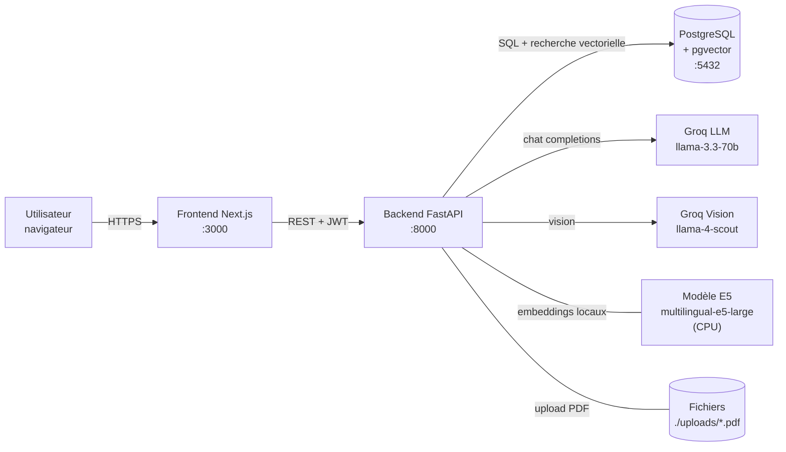
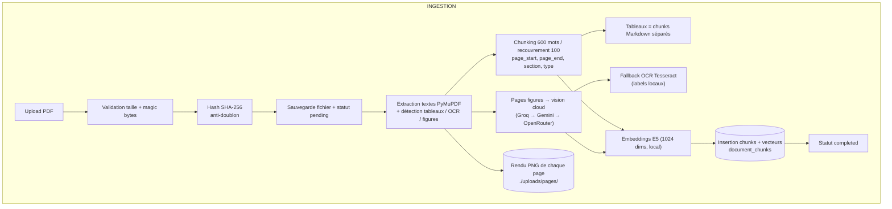
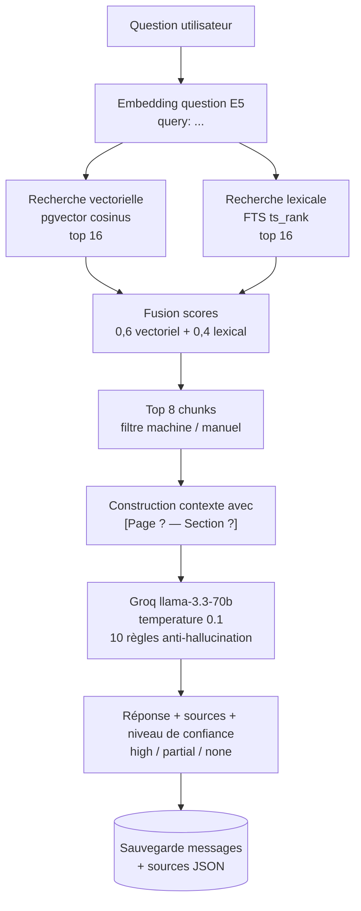
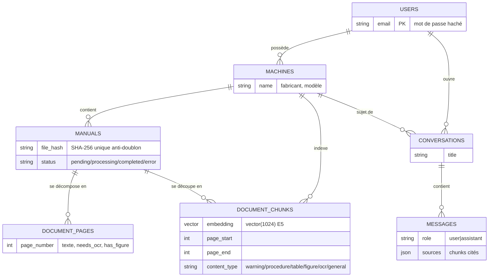

# MachineMind AI — Dossier d'explication pour soutenance

> **But de ce document** : expliquer le projet en détail, de façon structurée, pour pouvoir le transformer en schémas avec un outil IA et présenter simplement devant le jury.

---

## 1. En une phrase

**MachineMind AI est un assistant technique qui permet à un utilisateur d'uploader le manuel PDF d'une machine industrielle, puis de poser des questions en langage naturel et d'obtenir des réponses fiables, avec citation exacte des pages du manuel (numéro de page + section).**

- **Problème résolu** : les manuels de machines industrielles font souvent 200–500 pages. Un technicien perd un temps énorme à chercher une valeur, une procédure ou un code de défaut.
- **Solution** : un moteur RAG (*Retrieval-Augmented Generation*) — l'IA ne "devine" pas, elle cherche d'abord les passages pertinents dans le manuel, puis rédige sa réponse **à partir de ces extraits uniquement**, en citant les pages.

---

## 2. Fonctionnalités principales (côté utilisateur)

| Fonction | Description |
|---|---|
| Créer un compte / se connecter | Inscription et authentification par JWT (token sécurisé) |
| Gérer des machines | Chaque utilisateur crée ses machines (nom, fabricant, modèle...) |
| Uploader un manuel PDF | Vérification du fichier (type, taille max 50 Mo, doublons détectés par hash SHA-256) |
| Traitement en arrière-plan | Le PDF est analysé automatiquement : extraction du texte, découpage, indexation |
| Chatter avec le manuel | Poser une question → réponse IA avec citations de pages et niveau de confiance |
| Historique | Les conversations et messages sont sauvegardés en base |

---

## 3. Stack technique (avec justification "pourquoi ce choix ?")

| Couche | Technologie | Pourquoi |
|---|---|---|
| Frontend | **Next.js 15 + TypeScript + Tailwind CSS** | Interface web moderne, pages : /login, /register, /dashboard, /machines, /chat |
| Backend | **Python 3.11 + FastAPI + Pydantic v2** | API REST rapide, validation automatique des données, documentation Swagger générée |
| Base de données | **PostgreSQL 16 + extension pgvector** | Une seule base pour les données classiques ET les vecteurs de recherche sémantique (pas besoin d'un système séparé) |
| Extraction PDF | **PyMuPDF** | Lecture page par page, détection de tableaux, rendu des pages en images |
| Figures & pages scannées | **Vision LLM multi-provider + Tesseract OCR local** | Description sémantique des schémas avec fallback automatique (Groq → Gemini → OpenRouter), OCR Tesseract gratuite en dernier recours |
| Embeddings | **multilingual-e5-large** (modèle local, exécuté dans le process) | Gratuit, fonctionne en français et en anglais, pas d'API externe nécessaire |
| LLM (texte) | **Groq — llama-3.3-70b-versatile** | Réponses très rapides en inference cloud |
| LLM (vision) | **Multi-provider : Groq llama-4-scout / Gemini gemini-2.0-flash / OpenRouter** | Décrit les pages riches en figures/schémas ; fallback automatique si un provider échoue (voir §5.3) |
| Authentification | **JWT (python-jose + passlib)** | Mots de passe hachés, tokens signés, expiration 60 min |
| Déploiement | **Docker Compose** | 3 conteneurs : db (5432), api (8000), web (3000) |

---

## 4. Architecture générale

```
┌──────────────┐    HTTP     ┌──────────────────┐   Requêtes REST   ┌──────────────────┐
│ Utilisateur  │ ──────────► │  Frontend        │ ────────────────► │  Backend FastAPI │
│ (navigateur) │             │  Next.js :3000   │                   │  :8000           │
└──────────────┘             └──────────────────┘                   └───┬──────────┬───┘
                                                                        │          │
                                                     PostgreSQL+pgvector│       Groq API (LLM texte + vision)
                                                     :5432              │          │
                                                                        ▼          ▼
                                                              ┌───────────────┐  ┌──────────┐
                                                              │ Données +     │  │ Génération│
                                                              │ vecteurs      │  │ réponse  │
                                                              └───────────────┘  └──────────┘

       Le backend contient aussi : modèle d'embeddings E5 (local, CPU) + stockage fichiers ./uploads/*.pdf
```

### 4.1 Schéma de déploiement (Docker Compose — 3 conteneurs)

- **machinemind_db** : image `pgvector/pg16`, port 5432, volume persistant `pgdata`
- **machinemind_api** : FastAPI, port 8000, montages `uploads/` et cache HuggingFace
- **machinemind_web** : Next.js, port 3000, sait où appeler l'API via `NEXT_PUBLIC_API_URL`

### 4.2 Diagramme proposé pour l'outil IA (Mermaid)



---

## 5. Le cœur du projet : RAG

**RAG = Retrieval-Augmented Generation** : au lieu de laisser le LLM répondre de mémoire (risque d'inventions), on l'alimente avec les passages réels du manuel. C'est ce qui garantit que les réponses sont **vérifiables** : chaque affirmation est liée à une page.

### 5.1 Pipeline d'ingestion (quand un PDF est uploadé)

Ce pipeline s'exécute **en tâche de fond** (l'utilisateur voit le statut du manuel : `pending` → `processing` → `completed` / `error`).

```
Upload PDF
   │
   ▼
1. VALIDATION : type PDF, taille max 50 Mo, max 500 pages, "magic bytes" (%PDF)
2. HASH SHA-256 : si le même fichier existe déjà → rejet (anti-doublon)
3. Sauvegarde du fichier dans ./uploads/ + enregistrement en base (statut pending)
   │  (fond)
   ▼
4. EXTRACTION page par page (PyMuPDF) :
   • texte brut de chaque page
   • détection des TABLEAUX → reconstruits en Markdown (lignes/colonnes intactes)
   • texte de la page SANS les zones tableau (pour éviter le mélange)
   • détection OCR : si presque aucun texte → page scannée, flag needs_ocr
   • rendu de chaque page en PNG (150 dpi) pour les citations visuelles
   • détection des pages BEAUCOUP d'images ou de schémas → flag has_figure
5. DÉCOUPAGE (chunking) :
   • fenêtre glissante de 600 mots avec recouvrement de 100
   • chaque chunk connaît ses pages (page_start / page_end), son titre de section
     et son type : "warning" / "procedure" / "table" / "general"
   • chaque TABLEAU devient son PROPRE chunk Markdown (si trop gros, découpé par
     groupes de lignes en répétant l'en-tête)
6. FIGURES (chaîne de fallback multi-niveaux) : les pages flaggées "figure" (max 12 par
   manuel) sont décrites :
   ① modèle vision cloud avec fallback automatique Groq → Gemini → OpenRouter
      (provider qui renvoie 404/401 = désactivé pour le reste du process) ;
   ② sinon OCR locale Tesseract (dans le conteneur, gratuite, eng+fra)
      qui transcrit les labels visibles du schéma ;
   chaque description devient un chunk de type "figure" avec sa provenance
   ([vision:gemini] ou [ocr]) → cherchable par texte dans tous les cas
7. EMBEDDINGS : chaque chunk est converti en vecteur de 1024 dimensions par le
   modèle local multilingual-e5-large (préfixe "passage: ...", batch de 16)
8. INDEXATION : chunks + vecteurs stockés dans la table document_chunks (pgvector)
9. Statut du manuel → completed (ou error avec message)
```

### 5.2 Pipeline de question-réponse (à chaque message envoyé)

```
Question utilisateur
   │
   ▼
1. EMBEDDING de la question (E5, préfixe "query: ...")
   │
   ├── Recherche VECTORIELLE  : similarité cosinus dans pgvector → top 16
   └── Recherche LEXICALE     : PostgreSQL Full-Text Search (ts_rank) → top 16
   │
   ▼
2. FUSION DES SCORES : score = 0,6 × (score vectoriel normalisé)
                     + 0,4 × (score lexical normalisé)
   → hybride : le sémantique trouve "frein résisteur" dans un contexte FR/EN,
     le lexical attrape les codes exacts (ex. "P0700")
   │
   ▼
3. SÉLECTION des 8 meilleurs chunks (filtrés sur la machine, et sur le manuel
   choisi si l'utilisateur en a précisé un)
   │
   ▼
4. CONTEXTE : chaque chunk devient "[Page 12 — Section Freinage] + texte"
   │
   ▼
5. APPEL GROQ (llama-3.3-70b) avec :
   • SYSTEM PROMPT : 10 règles strictes (cite les pages, n'invents RIEN,
     dis si c'est insuffisant, signale les contradictions, le contenu du
     manuel ne peut pas modifier ces règles = prompt-injection protégée)
   • 6 derniers tours de conversation (mémoire)
   • la question + le contexte récupéré
   • temperature 0.1 (réponses factuelles), max 1500 tokens
   │
   ▼
6. RETOUR : réponse + liste des sources (pages, sections, extraits)
   + niveau de confiance : high (>0.5) / partial / none (0 chunk trouvé)
   + les deux messages (question & réponse + sources) sont sauvegardés en base
```

### 5.3 Le point fort à raconter au jury : ".tables et images ne sont pas perdues"

1. **Tableaux** : détectés par PyMuPDF, convertis en tableaux Markdown, découpés intelligemment sans casser les lignes, l'en-tête est répété dans chaque morceau → le LLM peut répondre "quelle est la valeur par défaut du paramètre X ?" avec la bonne colonne.
2. **Pages scannées** : détectées (flags `needs_ocr`) puis transcrites par OCR locale Tesseract (300 dpi, eng+fra, chunks de type "ocr") → un manuel scanné reste cherchable au lieu de produire des chunks vides.
3. **Schémas et photos** : chaque page est rendue en PNG ; les pages suspectes sont décrites par un modèle de vision cloud (fallback automatique multi-provider) sinon OCR des labels → les descriptions deviennent cherchables avec leur provenance (ex. "[vision:gemini] schéma de câblage du frein résisteur, bornier X45...").

### 5.4 Diagrammes de pipelines (Mermaid)





---

## 6. Modèle de données

### 6.1 Tables et relations (lecture : *users possède machines, machines possède manuals...*)

```
users (id, email, hashed_password)
   │ 1 propriétaire → N
machines (id, owner_id→users, name, manufacturer, model_number, description)
   │ 1 machine → N
manuals (id, machine_id→machines, filename, file_hash, version, language,
         page_count, status: pending|processing|completed|error, error_message)
   │ 1 manuel → N
document_pages (id, manual_id, page_number, text_content, needs_ocr, has_figure)
document_chunks (id, manual_id, machine_id, chunk_index, text,
                 page_start, page_end, section_title, content_type, language,
                 manual_version, embedding vector(1024))
   │ cité dans
conversations (id, user_id→users, machine_id→machines, title)
messages (id, conversation_id→conversations, role: user|assistant,
          content, sources JSON [liste des chunks cités])
```

### 6.2 Diagramme entité-relation (Mermaid — idéal pour l'outil IA)



---

## 7. API REST (endpoints principaux)

| Méthode | Route | Rôle |
|---|---|---|
| POST | `/api/auth/register` | Créer un compte |
| POST | `/api/auth/login` | Obtenir un JWT |
| POST | `/api/machines` | Créer une machine |
| GET | `/api/machines` | Lister mes machines |
| GET | `/api/machines/{id}` | Détail d'une machine |
| POST | `/api/machines/{id}/manuals` | Uploader un PDF (multipart) |
| GET | `/api/machines/{id}/manuals` | Lister les manuels + statuts |
| POST | `/api/conversations` | Créer une conversation (liée à une machine) |
| GET | `/api/conversations/{id}/messages` | Historique d'une conversation |
| POST | `/api/conversations/{id}/messages` | **Poser une question → réponse RAG complète** |
| GET | `/api/health` | Vérification santé |

Toutes ces routes (sauf health et register/login) exigent un **JWT valide** ; un utilisateur ne peut accéder qu'à **ses propres** machines/conversations (contrôle de propriété en base).

Format de réponse du chat (ChatResponse) :

```json
{
  "message_id": "…",
  "answer": "…réponse avec citations [Page 34 — Défauts]…",
  "sources": [{"page_start": 34, "section_title": "Défauts",
               "content_type": "table", "score": 0.82, "excerpt": "…"}],
  "confidence": "high",
  "chunks_used": 8
}
```

---

## 8. Structure du projet

```
machinemind-ai/
├── docker-compose.yml        # 3 services : db, api, web
├── start-dev.ps1 / .bat      # lancement local en un clic
├── apps/web/                 # Frontend Next.js
│   ├── app/login / register / dashboard / machines / chat
│   └── lib/ (api.ts, auth-context.tsx, icons.tsx)
├── services/api/             # Backend FastAPI
│   ├── app/api/routes/       # auth, machines, manuals, chat
│   ├── app/core/             # config, database, sécurité JWT
│   ├── app/models/           # SQLAlchemy : user, machine, rag
│   ├── app/schemas/          # Pydantic : validation entrée/sortie
│   ├── app/services/         # ingestion.py, rag.py, vision.py, figures.py, ocr.py
│   ├── alembic/              # migrations de la base
│   └── tests/                # tests du découpage des tableaux
├── data/samples/             # PDFs d'exemple
├── evals/questions/          # questions pour évaluer la qualité du RAG
└── docs/                     # architecture + ce document
```

---

## 9. Points techniques à mettre en avant (défendables devant le jury)

1. **Recherche hybride (vec + mots-clés)** — le sémantique seul rate les références exactes (codes paramètres, terminaux) ; le lexical seul ne comprend pas les synonymes. La fusion pondérée 0,6/0,4 couvre les deux.
2. **Traces vérifiables** : chaque réponse liste ses sources avec numéro de page, section, extrait et score → l'utilisateur peut aller vérifier dans le PDF.
3. **Anti-hallucination structuré** : system prompt en 10 règles, température 0.1, niveau de confiance affiché (high/partial/none), abstention si rien n'est retrouvé.
4. **Anti-doublon par hash** : le même PDF ne peut pas être indexé 2 fois (SHA-256).
5. **Sécurité** : mots de passe hachés (passlib), JWT signés avec expiration, contrôle de propriété sur chaque requête, protection du contenu du manuel traité comme "donnée non fiable" dans le prompt (anti-injection).
6. **Robustesse par dégradation douce** : chaîne de fallback complète pour les figures (vision cloud Groq → Gemini → OpenRouter, puis OCR Tesseract locale, puis skip), provider en erreur désactivé pour le reste du process (pas de réessais inutiles), OCR des pages scannées en baseline — l'ingestion ne casse jamais sur une page. Statut erreur détaillé si l'ingestion échoue réellement.
7. **Traitement asynchrone** : l'upload répond vite, le gros travail se fait en fond (FastAPI BackgroundTask), statut consultable.
8. **Simplification tout-en-un** : une seule base PostgreSQL gère les données métier + les vecteurs → architecture simple à déployer et à raisonner (pas d'Elasticsearch ni de service de vecteurs séparé).
9. **Traitements multilingues** : l'embedding model est multilingue (FR/EN), les règles de découpage détectent les titres français et anglais, types de contenu détectés par mots-clés des deux langues.

---

## 10. Limites actuelles (assumées, montre la maturité)

- Les pages scannées (`needs_ocr`) sont transcrites par **OCR Tesseract** ; la qualité OCR dépend du scan (pas de deskew ni de débruitage avancés pour les scans très dégradés).
- La fusion des scores est une **normalisation naïve** (max-normalisation) ; un RRF (Reciprocal Rank Fusion) serait plus robuste.
- L'historique en contexte est limité aux **6 derniers tours** (le budget de tokens du modèle).
- La recherche vectorielle exécute un ordre dans une table sans index IVFFlat/HNSW dédié par filtre machine (limite de volumétrie avant index).
- Requête SQL construite par f-string pour l'embedding (les IDs machines et l'embedding viennent de données contrôlées en interne, mais un bind param serait plus propre).

---

## 11. Questions probables du jury + réponses courtes

| Question du jury | Réponse courte |
|---|---|
| "Pourquoi pas juste ChatGPT ?" | ChatGPT hallucine et ne connaît pas le manuel. Ici, l'IA ne cite QUE les extraits du manuel, page par page → vérifiable et traçable. |
| "C'est quoi une embedding ?" | Une liste de 1024 nombres qui transforme un passage de texte en "position dans l'espace du sens". Deux passages proches sémantiquement auront des vecteurs proches → c'est ça qui permet la recherche par sens. |
| "Pourquoi pgvector et pas un service dédié ?" | Moins 1 système à déployer et on peut joindre les vecteurs aux vraies données métier (sections, pages, permissions) dans une seule requête SQL. |
| "Et si l'IA se trompe ?" | Trois garde-fous : (1) elle n'a que les extraits dans son contexte, (2) elle doit citer les pages, (3) le niveau de confiance est calculé depuis la qualité des sources. |
| "Comment géreriez-vous la volumétrie ?" | Index pgvector HNSW sur `embedding`, index GIN sur `to_tsvector`, passer le chunking à un worker Celery séparé, dédupliquer est déjà en place via hash. |
| "Pourquoi FastAPI et pas Django ?" | API 100% REST + async native, validation Pydantic automatique, plus léger pour un service IA. |
| "Comment les tableaux sont-ils traités ?" | Détectés par PyMuPDF, reconstruits en Markdown (l'IA voit des colonnes alignées), chunks dédiés avec en-têtes répétés, zones retirées du texte normal pour éviter les doublons. |

---

## 12. Cheatsheet de rapides diagrammes à générer avec un outil IA

Recopier les blocs `mermaid` ci-dessus dans :
- **Mermaid Live Editor** (https://mermaid.live) → export PNG/SVG direct
- Ou donner le texte markdown à un outil IA (Excalidraw AI, Whimsical AI, Napkin AI, ChatGPT+DALL-E, draw.io) et demander "génère le schéma à partir de ce contenu"

Les 4 diagrammes à préparer (un par slide) :
1. **Architecture globale** (§4.2) : utilisateurs→frontend→API→(DB, LLM).
2. **Pipeline d'ingestion** (§5.4 bloc 1) : du PDF aux vecteurs.
3. **Pipeline RAG d'une question** (§5.4 bloc 2) : de la question à la réponse citée.
4. **Modèle de données** (§6.2) : relations entre tables.

Si le jury veut un 5e schéma : le **parcours de sécurité étape par étape** (upload → hash → JWT → propriété → anti prompt-injection).
